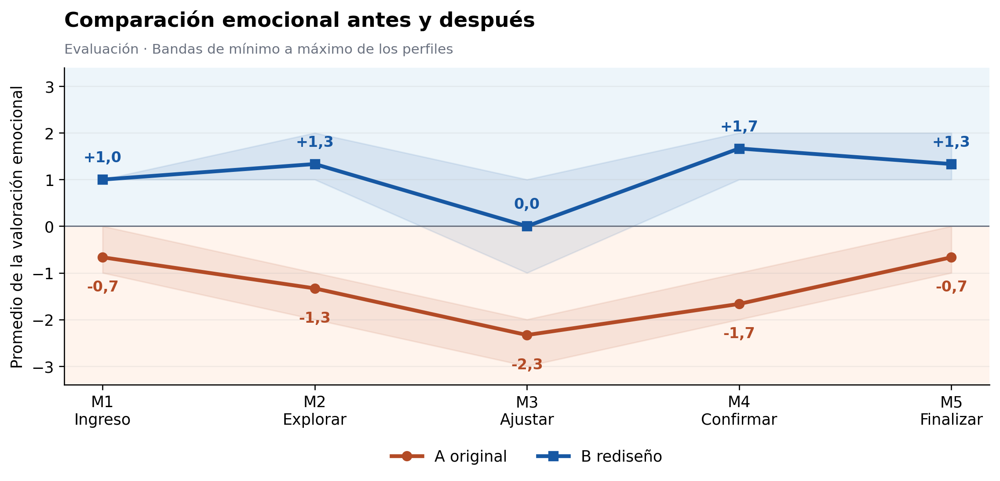
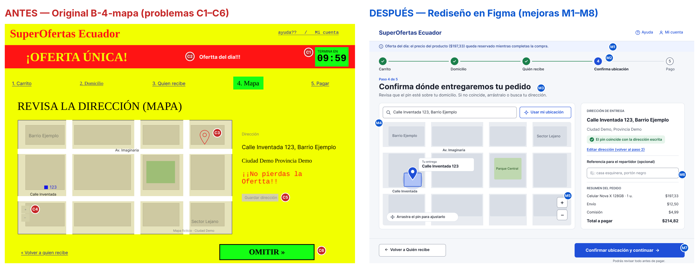

# Experiencia emocional del usuario · Pantalla «Mapa» (B-4)

**Universidad Técnica de Ambato · Facultad de Ingeniería en Sistemas, Electrónica e Industrial**  
Carrera de Software · 5to «A» · Interacción Humano-Computador  
Tarea grupal T2.1 · Emoción y experiencia de usuario · Entrega: viernes 16 de octubre de 2026

Análisis del mapa de verificación de una dirección de entrega, construcción de curvas emocionales, elaboración de la matriz UX y comparación del original con el rediseño.

- **Caso de estudio:** [pantalla original B-4](https://github.com/juANO2202/HCI-2026-G1/blob/main/prototipos/original/B-4-mapa.png.jpeg).
- **Prototipo en Figma:** [SuperOfertas Ecuador · Rediseño del mapa](https://www.figma.com/design/qHv7b4pqeDrXumpQNNd2FN).
- **Informe final:** [informe/informe_final.pdf](informe/informe_final.pdf).
- **Curva antes/después:** [curva_emocional/curva_emocional.png](curva_emocional/curva_emocional.png).
- **Matriz UX:** [matriz/matriz_ux.xlsx](matriz/matriz_ux.xlsx).

## Integrantes, roles y contribuciones

| Integrante | Rol | Tareas realizadas | Archivos a su cargo |
|---|---|---|---|
| Emilio Abril | Coordinación e informe | Integración del informe en formato APES, organización de la entrega y README | `README.md`, `informe/` |
| Manuel Cusme | Inspección · Actividad 1 | Definición de la tarea y de cinco momentos; capturas numeradas C1–C6 y evidencias del original | `evidencias/original/` |
| William Martínez | Curva emocional · Actividad 2 | Curvas individuales y promedio, comparación antes/después e identificación de momentos críticos | `curva_emocional/` |
| Pablo Lozada | Matriz UX · Actividad 3 | Relación entre momento, emoción, valoración, evidencia, mejora y fundamento IHC; utilidades de procesamiento | `matriz/`, `scripts/` |
| Jonathan Gamboa | Rediseño y verificación · Actividades 4–5 | Prototipo en Figma, estados del mapa, comparación visual y documentación de correcciones y alcance funcional | `rediseño/` |

Las contribuciones individuales se consultan en el [historial de commits](https://github.com/EMILIOABRIL05/IHC-T2.1-Experiencia-Emocional-UX/commits/main/) y en los [pull requests](https://github.com/EMILIOABRIL05/IHC-T2.1-Experiencia-Emocional-UX/pulls) del repositorio.

## Tarea y momentos de la experiencia

> Tu pedido debe llegar a **Calle Inventada 123, Barrio Ejemplo**. Verifica en el mapa que la ubicación de entrega sea la correcta, corrígela si hace falta y guarda la dirección para continuar al pago.

| Momento | Acción | Fase |
|---|---|---|
| M1 · Ingreso | Comprender el paso y qué se debe verificar | Antes |
| M2 · Explorar | Comparar la dirección escrita con el pin y el lote del mapa | Durante |
| M3 · Ajustar | Identificar cómo buscar o corregir el punto | Durante |
| M4 · Confirmar | Elegir la acción de guardado y comprender su resultado | Durante |
| M5 · Finalizar | Revisar la confirmación y el siguiente paso | Después |

La misma tarea y los mismos momentos organizan la comparación entre **A · Original** y **B · Rediseño**.

## Alcance y registros de la evaluación

El conjunto publicado contiene **30 valoraciones**, organizadas mediante los códigos **P1, P2 y P3**, dos versiones y cinco momentos por versión. La escala va de **−3 a +3**; cero corresponde a neutralidad. Cada entrada conserva versión, momento, puntuación, emoción anotada, nota de evaluación y captura de referencia.

- [Registro de las 30 valoraciones](evidencias/pruebas_usuarios/resultados/registros_evaluacion.csv).
- [Perfiles y orden de las versiones](evidencias/pruebas_usuarios/resultados/participantes.md).
- [Protocolo, tarea y escala](evidencias/pruebas_usuarios/protocolo_pruebas.md).
- [Resumen estadístico por momento](curva_emocional/resumen_resultados.csv).

Las curvas muestran las trayectorias individuales, el promedio y la variabilidad del conjunto. Las diferencias se expresan en puntos de la escala y se interpretan de forma descriptiva; no constituyen porcentajes de satisfacción ni permiten generalizar a una población o establecer causalidad.

La inspección visual, las valoraciones del registro y la revisión funcional del prototipo aportan información distinta. Una captura permite describir elementos visibles; las conexiones de Figma permiten revisar transiciones configuradas. El alcance funcional se documenta en [correcciones_pendientes.md](rediseño/correcciones_pendientes.md).

## Hallazgos del original

- **C1–C2 · Atención y credibilidad:** la promoción, el contador y los estilos de escritura compiten con la revisión de la dirección.
- **C3 · Correspondencia espacial:** el pin está en una manzana distinta a la del número 123 de Calle Inventada.
- **C4 · Orientación para corregir:** no se observa buscador ni pista de arrastre; los controles de zoom son pequeños y poco contrastados.
- **C5–C6 · Jerarquía de acciones:** «Guardar dirección» tiene poca presencia visual y «OMITIR» domina la pantalla. Las capturas originales no documentan una confirmación explícita del guardado.

Las evidencias están en [evidencias/original/](evidencias/original/), incluida la [pantalla anotada C1–C6](evidencias/original/B-4_anotado_C1-C6.png).

## Resultados antes y después

| Momento | Media A · Original | Media B · Rediseño | Diferencia B menos A |
|---|---:|---:|---:|
| M1 · Ingreso | −0,67 | +1,00 | +1,67 |
| M2 · Explorar | −1,33 | +1,33 | +2,67 |
| M3 · Ajustar | −2,33 | 0,00 | +2,33 |
| M4 · Confirmar | −1,67 | +1,67 | +3,33 |
| M5 · Finalizar | −0,67 | +1,33 | +2,00 |
| **Media global** | **−1,33** | **+1,07** | **+2,40** |

**M3 · Ajustar** y **M4 · Confirmar** son los dos momentos con menor media en el original. La mayor diferencia aparece en M4. M3 conserva una media neutra en el rediseño y un valor de −1 en P3, por lo que mantiene una dificultad residual que el promedio global no debe ocultar.

Otros gráficos disponibles:

- [Trayectorias individuales y promedio del original](curva_emocional/curvas_original.png).
- [Trayectorias individuales y promedio del rediseño](curva_emocional/curvas_rediseno.png).
- [Comparación emparejada por código P1–P3](curva_emocional/curvas_pareadas.png).
- [Mapa de las 30 valoraciones](curva_emocional/mapa_valoraciones.png).
- [Diferencias por momento](curva_emocional/diferencia_momentos.png).
- [Contraste visual de las muestras de color](curva_emocional/contraste_visual.png) y [datos de contraste](curva_emocional/contrastes.csv).

## Rediseño y verificación

La propuesta prioriza una jerarquía clara, la correspondencia entre dirección y pin, opciones visibles de corrección y retroalimentación al confirmar.

| Aspecto | Original | Rediseño documentado |
|---|---|---|
| Contraste del texto del botón principal | Aproximadamente 2,3:1 | Aproximadamente 6,6:1 |
| Tamaño del control de zoom | 32 × 30 píxeles en la captura | 44 × 44 unidades de diseño en Figma |
| Correspondencia entre pin y dirección | Discrepancia visible | Coincidencia visible en el estado correcto y advertencia en el estado alejado |
| Opciones visibles para corregir | Sin buscador ni pista de ajuste | Búsqueda, ubicación y pista de arrastre representadas |
| Retroalimentación del guardado | No documentada en las capturas originales | Mensaje de confirmación y opción «Deshacer» |
| Presión promocional | Contador y mensajes de urgencia | Encabezado centrado en la revisión de la entrega |

Los contrastes corresponden a muestras concretas de color. Los tamaños de captura y las unidades de Figma no certifican dimensiones CSS ni una conformidad completa con WCAG.

El registro de correcciones distingue los ajustes posteriores a la evaluación de los controles cuya interacción aún requiere completarse. La navegación de Figma no acredita geolocalización real ni persistencia de direcciones en un servidor. Los detalles y estados revisados están en [enlace_figma.md](rediseño/enlace_figma.md) y [correcciones_pendientes.md](rediseño/correcciones_pendientes.md).

## Estructura del repositorio

Los materiales se encuentran directamente en la raíz del repositorio:

| Ruta | Contenido |
|---|---|
| `README.md` | Presentación, equipo, tarea, resultados y enlaces |
| `evidencias/original/` | Capturas originales, pantalla anotada y recortes C1–C6 |
| `evidencias/pruebas_usuarios/` | Protocolo, registros, perfiles y kit HTML complementario |
| `curva_emocional/` | Siete gráficos PNG y dos archivos CSV |
| `matriz/` | `matriz_ux.xlsx` |
| `rediseño/` | Comparación visual, estados del mapa, enlace a Figma y correcciones |
| `informe/` | `informe_final.pdf` |
| `scripts/` | Utilidades de las etapas de inspección y procesamiento |

## Consulta de la entrega

1. Abrir el [informe final](informe/informe_final.pdf).
2. Consultar los [registros](evidencias/pruebas_usuarios/resultados/registros_evaluacion.csv), las [curvas](curva_emocional/) y la [matriz UX](matriz/matriz_ux.xlsx).
3. Revisar la [comparación visual](rediseño/antes_despues.png) y el [prototipo en Figma](https://www.figma.com/design/qHv7b4pqeDrXumpQNNd2FN).

El archivo [kit_prueba/index.html](evidencias/pruebas_usuarios/kit_prueba/index.html) puede abrirse en un navegador como instrumento complementario. Contiene recreaciones interactivas independientes de Figma; sus comportamientos no demuestran funciones del prototipo original ni del rediseño.
